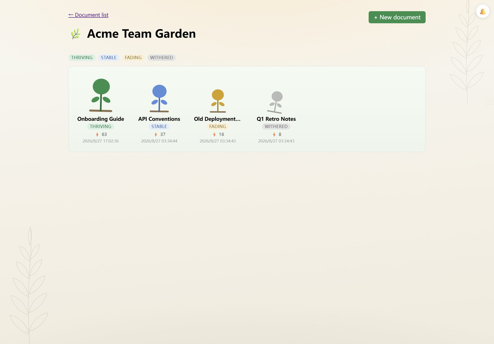
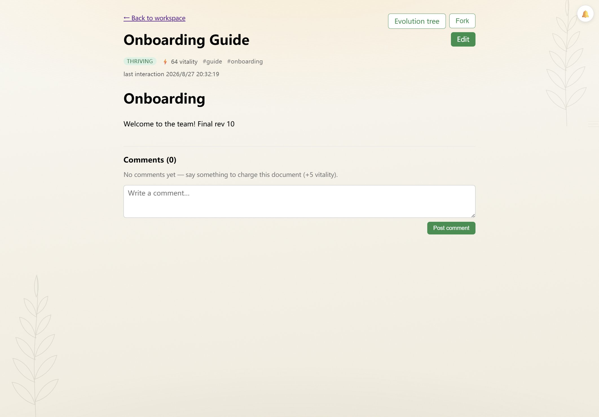
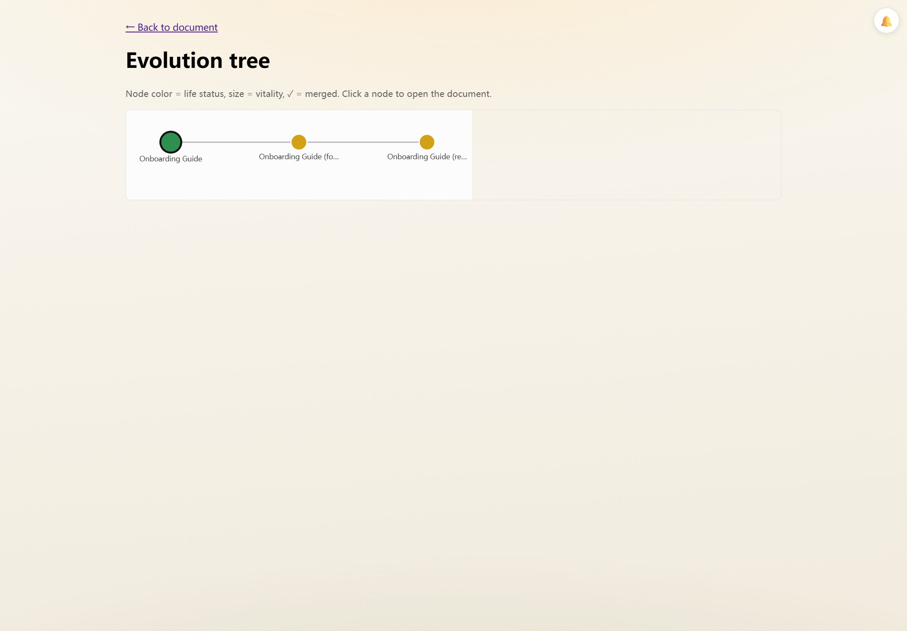

# Living Docs

> An open-source, async-first knowledge base for small teams where documents are **alive**: they grow when people interact with them, fork into variants that evolve on their own, and wither away when forgotten.

[](https://github.com/nsfxdyj/living-docs/actions/workflows/ci.yml)
[](LICENSE)

**[Live demo → living-docs.onrender.com](https://living-docs.onrender.com)** *(free tier: cold start ~30–60 s, data resets on redeploy)*

Existing knowledge bases treat documents as static files — written once, then left to rot. **Living Docs** turns every document into a living organism whose health reflects how much your team actually cares about it.

## Who this is for

Small teams (roughly 3–30 people) whose knowledge lives in chat threads
and abandoned wikis, and who want something self-hosted they can
actually run: one container, one SQLite file, no external services. The
life system makes stale knowledge visible instead of letting it rot
quietly, and fork & merge gives competing versions of a process document
a way to settle themselves.

## Core concepts

- **Life System** — every document has a `vitality` score charged by interactions (view = +1, comment = +5, edit = +8, fork = +10) and decayed daily. Documents move through `thriving → stable → fading → withered`; withered documents sink to the bottom and fade to grey, and can be revived by fresh interaction. The team home page is a *document garden* that shows at a glance which knowledge is alive and which is dead.
- **Fork & Merge** — any document can be forked into a variant that evolves independently; the stronger variant can later be merged back into the trunk, natural-selection style, with an evolution tree visualizing every descendant.

## Features

**Implemented**

- Email/password registration and login (JWT, argon2 password hashing)
- Workspaces with owner/member roles and shareable invite links (7-day expiry)
- Document CRUD: Markdown content, tags, status and trunk/fork filtering
- Full-text search over document titles and content (SQLite FTS5 with the trigram tokenizer, so CJK substrings like 「光合」 match 「光合作用」; queries shorter than 3 characters fall back to `LIKE`) with highlighted snippets; the index is updated transactionally on every write and rebuilt at startup if it drifts. If the SQLite build lacks FTS5, search returns `503` and document writes continue with indexing skipped
- Split-pane Markdown editor with live preview, syntax-highlighted code blocks (markdown-it + highlight.js), and DOMPurify-sanitized rendering
- Image attachments: upload (png/jpg/gif/webp, ≤ 2 MB, magic-byte verified) and inline embedding in documents
- Vitality hooks: views and edits record `Interaction` events and charge document vitality
- One-level comments on documents (+5 vitality per comment); authors or workspace owners can delete
- `@display_name` mentions in comments notify the mentioned workspace members (exact name match with word boundaries, so `x@Jane` inside an email address does not count; display names may not contain `@` or control characters and are capped at 40 chars). MVP tradeoffs: if several members share the exact same display name, a mention of that name notifies **nobody** (ambiguity is never guessed); mentions are throttled to one notification per (actor, target, document) per 10 minutes; a mentioned author gets only the mention, not a duplicate comment notification; mentions in document edits are intentionally not notified
- In-app notifications (comments, mentions, merge requests, merge decisions) with REST read markers and a live SSE stream
- Single-container deployment: the backend serves the built frontend and the API

**Roadmap** (see `PLAN.md` for the full milestone plan)

- M4 — full vitality engine: daily decay job (APScheduler), status transitions, revive, garden home page
- M5 — fork & merge with diff preview and evolution tree visualization

## Screenshots

**The document garden** — every document is a plant: size and color reflect vitality, withered documents gray out.



**Document view** — life status badge, vitality counter, tags and the comment section that charges the document.



**Evolution tree** — forks form a tree of variants; node color = life status, size = vitality.



## Quick start (Docker)

The only thing you need is Docker:

```sh
docker compose up --build
```

Then open http://localhost:8000 — the backend serves the built frontend and the API. The SQLite database is stored in the `living-docs-data` volume.

## Deploy to Render

The repo ships a [Render Blueprint](https://render.com/docs/blueprint-spec) (`render.yaml`), so a hosted demo is a few clicks:

1. Push this repository to GitHub.
2. In the Render dashboard: **New → Blueprint**, select the repo, apply.
3. Render builds the root `Dockerfile` and generates `LIVING_DOCS_SECRET_KEY` automatically.

Free-tier caveats:

- **Cold starts** — free web services spin down after inactivity; the first request after idle can take ~30–60 s.
- **Ephemeral data** — free services cannot attach disks, so the SQLite database and uploaded attachments live on the container filesystem (`/tmp`) and **reset on every deploy or restart**. Fine for a public demo; for a persistent instance use a paid plan and add a disk mounted at `/data`, then point `LIVING_DOCS_DATABASE_URL` / `LIVING_DOCS_ATTACHMENTS_DIR` there.
- **Single process by design** — notifications fan out through in-memory SSE queues and the FTS5 search index is rebuilt at process startup, so run exactly one worker. A multi-worker deployment would need a real notification broker and a shared/external search index.

## Local development

**Backend** (Python 3.12+):

```sh
cd backend
pip install -r requirements-dev.txt
uvicorn app.main:app --reload   # http://localhost:8000
python -m pytest                # run the test suite
```

**Frontend** (Node 20+):

```sh
cd frontend
npm install
npm run dev                     # http://localhost:5173 (proxies /api to :8000)
npm run build                   # production build into frontend/dist
```

## Configuration

All settings are environment variables with the `LIVING_DOCS_` prefix:

| Variable | Default | Description |
|---|---|---|
| `LIVING_DOCS_DATABASE_URL` | `sqlite:///./living_docs.db` | SQLAlchemy database URL |
| `LIVING_DOCS_STATIC_DIR` | `static` | Directory with the built frontend (served at `/`) |
| `LIVING_DOCS_SECRET_KEY` | `dev-only-secret-change-me` | JWT signing key — **set this in production** |
| `LIVING_DOCS_ATTACHMENTS_DIR` | `data/attachments` | Directory where uploaded images are stored |
| `LIVING_DOCS_MAX_UPLOAD_BYTES` | `2097152` (2 MB) | Maximum size of a single uploaded attachment |

## API overview

All endpoints except `/api/health`, `/api/auth/register` and `/api/auth/login` require an `Authorization: Bearer <token>` header. Workspace-scoped endpoints additionally require membership in that workspace.

| Method | Path | Description |
|---|---|---|
| `GET` | `/api/health` | Health check |
| `POST` | `/api/auth/register` | Register (first user gets a default workspace) |
| `POST` | `/api/auth/login` | Log in, returns a JWT |
| `GET` | `/api/auth/me` | Current user profile |
| `POST` | `/api/workspaces` | Create a workspace |
| `GET` | `/api/workspaces` | List my workspaces |
| `GET` | `/api/workspaces/{id}` | Workspace details incl. members |
| `POST` | `/api/workspaces/{id}/invites` | Create an invite link (owner only) |
| `POST` | `/api/workspaces/join` | Join a workspace via invite token |
| `POST` | `/api/workspaces/{id}/documents` | Create a document (`title`, `content_md`, `tags`) |
| `GET` | `/api/workspaces/{id}/documents` | List documents; `?q=` title search, `?status=` filter, `?parent=null` for trunk docs |
| `GET` | `/api/workspaces/{id}/search` | Full-text search (FTS5 trigram, title + content; `?q=` ≤ 200 chars); returns up to 50 hits with highlighted snippets, merged documents excluded; `503` if FTS5 is unavailable |
| `GET` | `/api/documents/{id}` | Document details (records a `view` interaction, +1 vitality) |
| `PATCH` | `/api/documents/{id}` | Edit a document (any member; records an `edit` interaction, +8 vitality) |
| `DELETE` | `/api/documents/{id}` | Delete a document (author or workspace owner only) |
| `POST` | `/api/documents/{id}/attachments` | Upload an image (multipart, png/jpg/gif/webp, ≤ 2 MB) |
| `GET` | `/api/attachments/{filename}` | Download an attachment |
| `POST` | `/api/documents/{id}/comments` | Comment on a document (≤ 2000 chars; records a `comment` interaction, +5 vitality; notifies the author; `@display_name` mentions notify those members) |
| `GET` | `/api/documents/{id}/comments` | List a document's comments, oldest first |
| `DELETE` | `/api/comments/{id}` | Delete a comment (author or workspace owner only) |
| `GET` | `/api/notifications` | My notifications, newest first (max 50) |
| `POST` | `/api/notifications/{id}/read` | Mark one notification as read |
| `POST` | `/api/notifications/read-all` | Mark all my notifications as read |
| `GET` | `/api/notifications/stream` | SSE live stream of new notifications (`text/event-stream`; accepts `?token=` because EventSource cannot send headers) |

Interactive API docs (Swagger UI) are available at `/docs` when the backend is running.

## Project structure

```
living-docs/
├── docker-compose.yml        # single-service deployment (app + data volume)
├── Dockerfile                # multi-stage: builds frontend, serves via backend
├── render.yaml               # Render Blueprint (one-click hosted demo)
├── PLAN.md                   # product plan and milestone roadmap
├── backend/
│   ├── app/
│   │   ├── main.py           # FastAPI app, router wiring, static hosting
│   │   ├── config.py         # LIVING_DOCS_* settings (pydantic-settings)
│   │   ├── db.py             # engine, session factory, declarative base
│   │   ├── models/           # SQLAlchemy ORM models (users, docs, vitality…)
│   │   ├── schemas.py        # Pydantic request/response schemas
│   │   ├── security.py       # argon2 hashing + JWT helpers
│   │   ├── notify.py         # notification persistence + in-process SSE fan-out
│   │   ├── search.py         # FTS5 full-text index (sync, rebuild, queries)
│   │   └── api/              # routers: auth, workspaces, documents, evolution,
│   │                         #   comments, notifications, attachments, search,
│   │                         #   health
│   └── tests/                # pytest suite (TestClient, in-memory SQLite)
└── frontend/
    └── src/
        ├── api/              # fetch wrapper (client.ts) + shared types
        ├── stores/           # Pinia auth + notifications stores
        ├── router/           # Vue Router with auth guard
        ├── utils/markdown.ts # markdown-it + highlight.js + DOMPurify
        └── views/            # Home, Login, Register, Join, Workspace,
                              #   DocumentView, DocumentEditView
```

## Testing

```sh
cd backend
python -m pytest        # auth, workspaces, documents, attachments, health
```

The suite runs against an in-memory SQLite database and a temporary attachments directory, so it never touches your local data.

## Contributing

Contributions are welcome! Please open an issue to discuss larger changes first, keep PRs focused on a single concern, and make sure `python -m pytest` (backend) and `npm run build` (frontend) pass. A formal `CONTRIBUTING.md` will be added in a later milestone.

## Custom deployment

Need a private deployment, SSO/LDAP integration, a different storage
backend, or features tuned to your team's workflow? I take on custom
development and private-deployment support: nsfxdyj@gmail.com

## License

[Apache-2.0](LICENSE) — copyright 2026 nsfxdyj.
